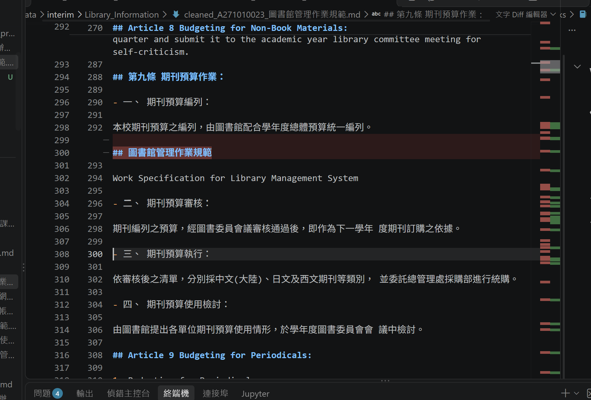
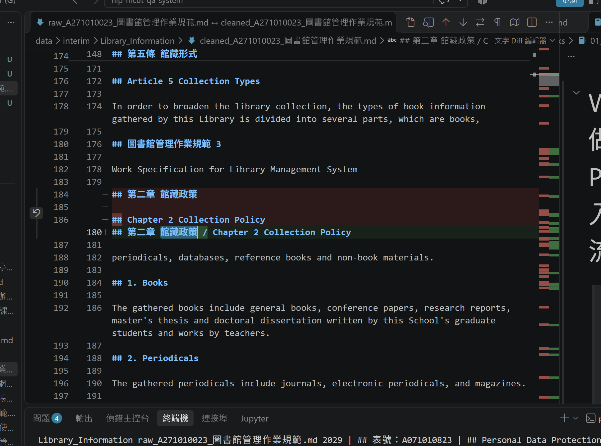
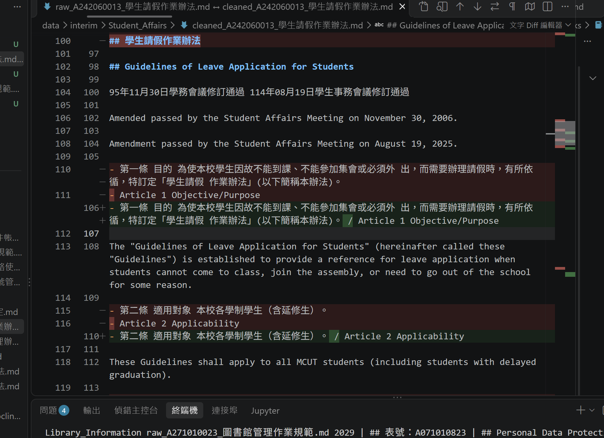
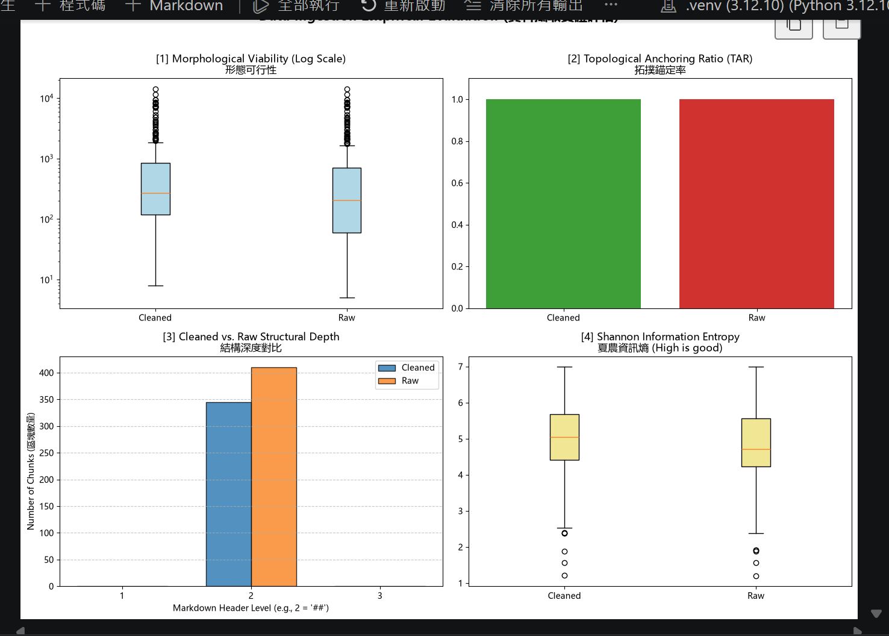

# 資料前處理報告 (Data Preparation Report)


- **學號 / 姓名**：U12627014 / 林孟軒
- **專案名稱**：nlp-mcut-qa-system
- **完成的任務**：- [x] 1-A 頁首頁尾清除　- [x] 1-B 雙語標題合併　- [x] 1-C 雙語條文合併

---
## 摘要 (Summary)

本報告記錄將 9 份校園規章 PDF (學務、教務、圖書資訊三類) 轉成問答系統可用語料的前處理過程。我先用 Docling 把 PDF 轉成 Markdown，再以三條 AI 協助撰寫的正則表示式清洗：1-A 依檔名動態刪除重複的中文頁首、1-B 合併相鄰的中英文 `##` 標題、1-C 合併中英對照的條文，最後以 `## ` 標題切塊並輸出 JSON。

清洗後 chunk 數從 410 減為 345 (約 -16%)，中位數長度由 204 增至 272 字元，中位數資訊熵由 4.71 升至 5.05，代表碎片減少、每塊內容更完整。TAR 前後皆為 1.0，是因為切塊規則本身就以 `##` 切開，無法反映清洗效果。

查證中也發現仍待解決的問題：(1) 帶頁碼的頁首與英文頁首沒被 1-A 刪除，形成只有頁首的空 chunk 並切斷跨頁句子；(2) 1-B、1-C 只檢查第二行是否為英文，造成「表號」標題、Docling 轉壞的佔位符被誤合併；(3) 條文以 `- ` 開頭時不會被切開，出現長達 8506 字元、包含 14 條條文的超長 chunk；(4) 附件空白表格形成資訊熵極低的 chunk。後續可改進方向為：放寬頁首正則、加入第一行必須是中文的限制、以「第X條」作為額外切點並設長度上限、過濾低熵表格 chunk。

## 1. 資料集概覽 (Dataset Overview)


| 類別 (Cluster) | PDF 數量 | 清洗前 chunk 數 | 清洗後 chunk 數 |
|---|---|---|---|
| Academic_Affairs | 3 | 96 | 65 |
| Library_Information | 3 | 248 | 225 |
| Student_Affairs | 3 | 66 | 55 |
| **合計** | **9** | **410** | **345** |

**問題 (2–3 句)：** 清洗後 chunk 數量變少了多少？是哪個任務造成的？有沒有哪個任務**不影響** chunk 數量？為什麼？

清洗後 chunk 從 410 個減少到 345 個，少了 65 個 (約 16%)。減少主要來自 1-A (刪除重複的 `##` 頁首) 和 1-B (把連續的中英文 `##` 標題合併成一行)，因為切塊規則是遇到 `## ` 標題就切一塊，`##` 變少 chunk 就變少。1-C 不影響 chunk 數量，因為它合併的是 `- ` 開頭的條文，不會增加或減少 `##` 標題。

## 2. 清洗步驟 (Cleaning Steps)


### 2.1 任務 1-A：頁首頁尾溢出清除

- 檔名：raw_A271010023_圖書館管理作業規範.md ↔ cleaned_A271010023_圖書館管理作業規範.md　搜尋的文字：## 圖書館管理作業規範 (raw 第 300 行)
- 截圖 (存為 `reports/figures/1a_compare.png`)：
- 改變了什麼：raw 第 300 行的換頁頁首「## 圖書館管理作業規範」被刪除。它原本夾在第九條期刊預算作業的第一項與第二項中間，刪除後兩項條文重新接在一起；整份檔案共有 12 行這樣的頁首被刪除。
- 這對之後的問答檢索有什麼幫助：這行頁首前面有 `##`，如果沒刪，切塊時會被當成一個新標題，把第九條切成兩半，後半段變成標題是「圖書館管理作業規範」、與內容無關的 chunk。刪除後第九條保持完整，檢索時能找到正確的條文與標題。
- 這個任務有沒有**改錯**的地方 (把不該改的也改了)？若有，寫出檔名與搜尋的文字；若沒有，寫「沒有發現」：沒有發現改錯，但有「漏刪」：同一份檔案第 302 行的英文頁首「Work Specification for Library Management System」沒有被刪除，因為 1-A 只用檔名中的中文法規名稱比對，英文頁首仍然殘留在第九條中間。

### 2.2 任務 1-B：雙語標題合併

- 檔名：raw_A271010023_圖書館管理作業規範.md ↔ cleaned_A271010023_圖書館管理作業規範.md　搜尋的文字：館藏政策 (raw 第 184–186 行)
- 截圖 (存為 `reports/figures/1b_compare.png`)：
- 改變了什麼：raw 第 184 行的「## 第二章 館藏政策」與第 186 行的「## Chapter 2 Collection Policy」原本是兩個獨立的 `##` 標題，中間隔一個空行；清洗後合併為一行「## 第二章 館藏政策 / Chapter 2 Collection Policy」。
- 這對之後的問答檢索有什麼幫助：合併前，中文標題「## 第二章 館藏政策」會自成一個只有標題、沒有內文的 chunk；合併後中英文標題在同一個 chunk，下面的內文也歸在這個雙語標題底下，用中文或英文問「館藏政策」都能找到同一個完整的 chunk。
- 這個任務有沒有**改錯**的地方 (把不該改的也改了)？若有，寫出檔名與搜尋的文字；若沒有，寫「沒有發現」：有。raw_A271010023_圖書館管理作業規範.md 第 2029 行，搜尋「表號：A071010823」：表單編號「## 表號：A071010823」被當成中文標題，和下一行英文表單名稱「## Personal Data Protection Statement...」合併。另外 raw_A232020018_大學部學則.md 第 236 行，搜尋「Part 2 Undergraduate Division」：兩個都是英文的「## Part 2 Undergraduate Division」(篇) 與「## Chapter 1 Admissions」(章) 也被合併。原因是 1-B 只檢查第二個標題是否以英文字母開頭，沒有檢查第一個標題是不是中文。

### 2.3 任務 1-C：雙語條文合併

- 檔名：raw_A242060013_學生請假作業辦法.md ↔ cleaned_A242060013_學生請假作業辦法.md　搜尋的文字：Article 1 Objective (raw 第 110–111 行、第 115–116 行)
- 截圖 (存為 `reports/figures/1c_compare.png`)：
- 改變了什麼：raw 中中文條文「- 第一條 目的 ...」與英文「- Article 1 Objective/Purpose」是兩個獨立的清單項目；清洗後合併成一行「- 第一條 目的 ...(以下簡稱本辦法)。 / Article 1 Objective/Purpose」。第二條「適用對象」與「Article 2 Applicability」也以同樣方式合併。
- 這對之後的問答檢索有什麼幫助：同一條規定的中文與英文編號放在一起，用中文問「請假辦法的目的」或用英文問「Article 1」都能對應到同一條，中英文不會在檢索時被當成兩段無關的文字。
- 這個任務有沒有**改錯**的地方 (把不該改的也改了)？若有，寫出檔名與搜尋的文字；若沒有，寫「沒有發現」：有。cleaned_A242060013_學生請假作業辦法.md 第 114 行，搜尋「formula-not-decoded」：中文第三條被 Docling 轉成 `<!-- formula-not-decoded -->` 佔位符，1-C 仍把「Article 3 Method of Application」接在這個佔位符後面，變成「<!-- formula-not-decoded --> / Article 3 ...」，中文內容完全遺失。另外第 207 行，搜尋「Indigenous ceremonial leave」：標題「## 7. Indigenous ceremonial leave」和下一段英文內文被合併成同一行標題。原因是 1-C 只檢查第二行是否為「- 英文字母」開頭，對前一行是什麼 (佔位符、標題) 完全沒有限制。

## 3. 評估指標與 AI 解讀查證 (Metrics & Verifying the AI's Interpretation)

### 3.1 指標數據表


 | 指標 | Raw | Cleaned (你的) | Cleaned (參考值) |
 |---|---|---|---|
 | [1] 中位數長度 Median Length | 204.0 | 272.0 | (課堂未顯示；參考 Raw 為 205.0) |
 | [2] 拓撲錨定率 TAR | 1.0 | 1.0 | 1.0 |
 | [3] 深度變異量 SDV (選填) | 0.0 | 0.0 | 0.0 |
 | [4] 中位數資訊熵 Entropy (選填) | 4.71 | 5.05 | 5.06 |




你的 Cleaned 結果與參考值一致嗎？若一致，寫「一致」；若不一致，找出原因。（1 句）

 大致一致但不完全相同：TAR 與 SDV 完全一致，資訊熵 (5.05 vs 5.06) 與中位數長度只差一點。因為連清洗前的 Raw 數值也不同 (204 vs 205、4.71 vs 4.72)，差異應該來自清洗之前的 Docling 轉換 (例如版本或執行環境不同)，而不是 1-A/1-B/1-C 的正則表示式。

### 3.2 AI 的解讀


- 使用的 AI 工具：claude

```text
整體結論：清洗 (1-A/1-B/1-C) 讓 chunk 變少、變完整、資訊密度提高，但有兩個指標因為切塊規則本身的限制，沒有反映出差異。

[1] 形態可行性 (長度，對數刻度)
- Cleaned 的中位數長度明顯比 Raw 高 (約 270 vs 200 字元)，箱子整體往上移，最短的 chunk 也變長。這代表清洗把原本被拆碎的雙語標題與條文合併，減少了「只有一行標題」的碎片。
- 兩邊上方都有大量離群值，最長接近 10^4 (約一萬字元)，清洗並沒有解決超長 chunk 的問題。這些超長 chunk 很可能是多條條文黏在同一塊，對之後的檢索是最大的風險。

[2] 拓撲錨定率 TAR
- Cleaned 與 Raw 都是 1.0，代表 100% 的 chunk 都以 ## 標題開頭。
- 但這不代表清洗沒效果：因為切塊規則本來就是「遇到 ## 就切」，每個 chunk 天生就以 ## 開頭，所以 TAR 在這個切法下幾乎一定是 1.0，這個指標無法區分清洗前後的好壞。

[3] 結構深度
- 所有 chunk 的標題都在第 2 層 (##)，沒有任何 # 或 ### 的 chunk，所以深度變異量 SDV = 0。
- 這表示 Docling 把章、條、附件全部輸出成同一層 ## 標題，文件原本「章 > 條 > 項」的階層資訊遺失了。
- Cleaned (約 345) 比 Raw (約 410) 少了約 65 個 chunk，減少的部分來自 1-A 刪除頁首與 1-B 合併雙語標題。

[4] 夏農資訊熵
- Cleaned 的中位數資訊熵高於 Raw (約 5.05 vs 4.7)，代表清洗後每個 chunk 的內容較豐富、重複較少。
- 兩邊下方都有幾個熵很低 (約 1~2.5) 的離群值，這些通常是空白表格、只有框線或重複符號的 chunk，對問答沒有幫助，建議過濾。

建議：
1. 對超長 chunk 加入長度上限或改以「第X條」為切點再切一次。
2. TAR 在目前的切塊規則下恆為 1.0，需要換一個能反映品質的指標。
3. 過濾資訊熵過低 (例如 < 3) 的表格型 chunk。
```

### 3.3 你的查證 (至少兩點)

**查證 1**
- AI 的說法：「兩邊上方的超長 chunk (接近一萬字元) 很可能是多條條文黏在同一塊。」
- 我查了什麼 (哪個檔案、哪個 chunk、哪段程式)：用 `09_midterm_chunks.ipynb` 分到的長 chunk (cleaned_A232020018_大學部學則.md 第 420 行，8506 字元)，從第 420 行讀到下一個 `## ` (第 499 行「第四章」)，並看 notebook 第 5 節的切塊規則 (只在 `## ` 切開)。
- 結論：正確，因為這個 chunk 裡包含第二十九條到第四十二條共 14 條，後面的條文開頭是 `- ` 不是 `## `，所以沒有被切開。不過我只檢查了一個長 chunk，其他離群值是否都是同樣原因還需要再看。

**查證 2**
- AI 的說法：「下方熵很低 (約 1~2.5) 的離群值，通常是空白表格、只有框線或重複符號的 chunk。」
- 我查了什麼：在終端機用程式列出所有 cleaned chunk 中資訊熵最低的 5 個：1.21 圖書館管理作業規範 Attachment 5 對照表、1.57 學生抵免學分辦法申請表、1.88 圖書館 Periodical Request 申請表、2.38 抵免學分填寫表格、2.39 學生抵免學分辦法目錄 (Table of Contents)。
- 結論：部分正確，因為最低的 5 個確實全部都是表格，前 4 個是申請表或對照表；但第 5 個是「目錄」，不是空白表格，它雖然熵低，卻有條文名稱與頁碼，對問「某條規定在哪裡」可能還有一點用，不應該全部直接過濾掉。

### 3.4 實際證據：你被指定的 chunk


- **SEED**：1106

**(a) 很長的 chunk**
- 資料檔 (JSON)：data/processed/Academic_Affairs/cleaned_A232020018_大學部學則_processed.json　位置：第 8 個 (從 0 開始數)　長度：8506 字元　驗證碼：39edddbc
- 閱讀用檔案 (`.md`)：data/interim/Academic_Affairs/cleaned_A232020018_大學部學則.md　從第 420 行開始
- 前 3 行內容：
  ```text
  ## 第二十九條 學生之學期學業平均成績與畢業成績採下列方法計算：
  - 一、 以每學期科目之學分數乘以該科目成績或等第點數 為該科目積分。
  - 二、 以每學期所修各科目學分數之總和為學分總數。
  ```
- 這是什麼樣的文字？為什麼會這麼長？這是大學部學則第三章關於成績與學分的條文，從第 420 行的第二十九條一直到第 498 行，下一個 `##` 是第 499 行的「第四章」，總共包含第二十九條到第四十二條共 14 條。第二十九條之後的條文開頭是 `- ` 而不是 `## ` (例如第 497 行的「- 第四十二條」)，切塊規則只在 `## ` 切開，所以 14 條條文連同英文翻譯全部黏在同一個 chunk，長度才會到 8506 字元。
- 之後做問答檢索時，這麼長的 chunk 可能造成什麼問題？一個 chunk 裡混了 14 條不同主題的條文 (成績計算、補考、抵免學分等)，向量會被平均掉，問「畢業成績怎麼算」時不一定能精準找到；而且太長可能超過模型的上下文長度、浪費 token，回答也容易引用到不相關的條文。

**(b) 資訊熵很低的 chunk**
- 資料檔 (JSON)：data/processed/Academic_Affairs/cleaned_A232060013_學生抵免學分辦法_processed.json　位置：第 25 個 (從 0 開始數)　資訊熵：3.06　驗證碼：f1fb814b
- 閱讀用檔案 (`.md`)：data/interim/Academic_Affairs/cleaned_A232060013_學生抵免學分辦法.md　從第 277 行開始
- 內容：
  ```text
  ## 明 志 科 技 大 學 學 分 抵 免 申 請 書 Ming Chi University of Technology Credit Transfer Application Form

  - [ ] □博士班 □碩士班 □四技部

  | 系所(學位學程)   | 班 級   | 姓 名   | 學 號   | 申 請 日 期   |
  |------------------|---------|---------|---------|---------------|

  請依照抵免科目依序填寫

  | 抵       | 擬抵免科目(請依課程總表)   | 擬抵免科目(請依課程總表)   | ... | 審查結果 |
  |----------|----------------------------|----------------------------|
  (以下為空白表格框線，全長 4367 字元)
  ```
- 為什麼它的資訊熵這麼低？它對問答檢索有用嗎？這是抵免學分辦法最後附的空白申請書表格，沒有任何規定內容。4367 個字元裡大部分是表格框線 `|`、`-` 和空白 (第 287 行之後幾乎全是 `-----|`)，加上「擬抵免科目(請依課程總表)」等欄位名稱重複很多次，字元種類少又一直重複，所以資訊熵只有 3.06。它對問答幾乎沒有用，最多只能回答「申請書有哪些欄位」，反而可能在檢索時被誤抓、浪費 token，可以考慮在切塊後把這種以表格框線為主的 chunk 過濾掉。


## 4. 一個尚未解決的問題 (One Remaining Problem)


- **檔名** (`cleaned_*.md`)：cleaned_A271010023_圖書館管理作業規範.md　**從第 176 行開始** (VS Code 左側的行號)　**標題**：## 圖書館管理作業規範 3
- **我是怎麼找到的** (例如：搜尋了什麼、看了哪個檔案)：做第 2.2 節 1-B 截圖時，在 raw 與 cleaned 的比較畫面搜尋「館藏政策」，發現上方有一行頁首沒有被刪除，而且英文句子被切斷。
- **問題 chunk (貼上部分內容)**：

```text
## 圖書館管理作業規範 3

Work Specification for Library Management System
```

- **問題是什麼**：這個 chunk 只有殘留的頁首「圖書館管理作業規範 3」(後面多了頁碼 3) 與英文頁首「Work Specification for Library Management System」，沒有任何規定內容。而且它把第五條英文內文切成兩半：第 174 行「...which are books,」在這個 chunk 之前，後半句「periodicals, databases, reference books and non-book materials.」(第 182 行) 卻跑到下一個 chunk「## 第二章 館藏政策 / Chapter 2 Collection Policy」裡面。
- **可能的原因** (PDF 本身？Docling 轉換？清洗的正則表示式？切塊規則？)：PDF 每頁都有中英文頁首與頁碼，Docling 把頁首加上 `##` 並和頁碼接在同一行。1-A 的正則要求「整行只有法規名稱」，所以後面多了「3」的這行沒被刪，英文頁首也不在 1-A 的比對範圍內；切塊規則遇到 `## ` 就切，於是產生這個只有頁首的 chunk，也把跨頁的句子切斷。
- **具體的修正方法** (例如：一條規則、一個正則表示式的構想、長度上限)：把 1-A 的清除正則改成允許結尾有頁碼，例如 `rf"^[ \t]*(##[ \t]*)?{re.escape(doc_title)}[ \t]*\d*[ \t]*\n+"`；另外把英文頁首「Work Specification for Library Management System」也加入清除清單 (可從文件第一頁的英文標題自動取得)。切塊後再加一條規則：去掉頁首後如果 chunk 少於約 30 字元就丟棄或併入前一個 chunk。
- **對問答檢索的影響**：這個 chunk 沒有內容，卻帶著「圖書館管理作業規範」的關鍵字，問圖書館相關問題時可能被檢索出來、佔掉名額；而被切斷的句子讓第五條「館藏類型」的完整答案 (圖書、期刊、資料庫…) 分散在兩個 chunk，其中一半還被錯放在「第二章 館藏政策」底下，回答「館藏有哪些類型」時可能只答出一部分。

## 5. AI 協作 (AI Collaboration)

- 本次作業的 AI 協作紀錄請見 [`AI_USAGE.md`](AI_USAGE.md) 的「Week 04 / 08」與「Week 09」段落。
- 這次使用 AI 最大的收穫或教訓是：AI 對儀表板的解讀聽起來都很肯定，但查證後發現不能全信。例如 AI 說熵很低的 chunk「通常是空白表格」，我用程式列出最低的 5 個，發現第 5 個其實是目錄，不是空白表格；AI 說超長 chunk 是多條條文黏在一起，我也只能在打開 8506 字元的那個 chunk 後才確認是第二十九條到第四十二條共 14 條。教訓是 AI 的解讀要回到實際檔案和程式碼驗證，數字背後的原因只有自己打開檔案才看得到。
